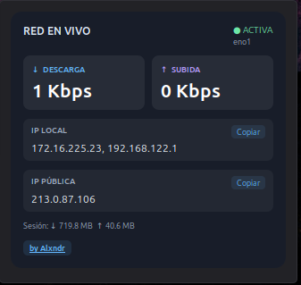

# Red en vivo

Desklet para Cinnamon que muestra la velocidad de descarga y subida, la interfaz
activa, el tráfico acumulado durante la sesión y las IP local y pública. Las
velocidades se actualizan cada segundo; la IP pública se consulta una vez por
minuto mediante `api.ipify.org`. Cada IP tiene un botón para copiarla.

## Instalación

1. Clona este repositorio en
   `~/.local/share/cinnamon/desklets/netinfo@local`.
2. Activa **Red en vivo** desde la aplicación **Desklets** de Cinnamon.
3. Usa el clic derecho en el escritorio para ajustar el tamaño.

La IP pública requiere conexión a Internet y `curl`. El resto de datos se
obtiene localmente desde Linux.
